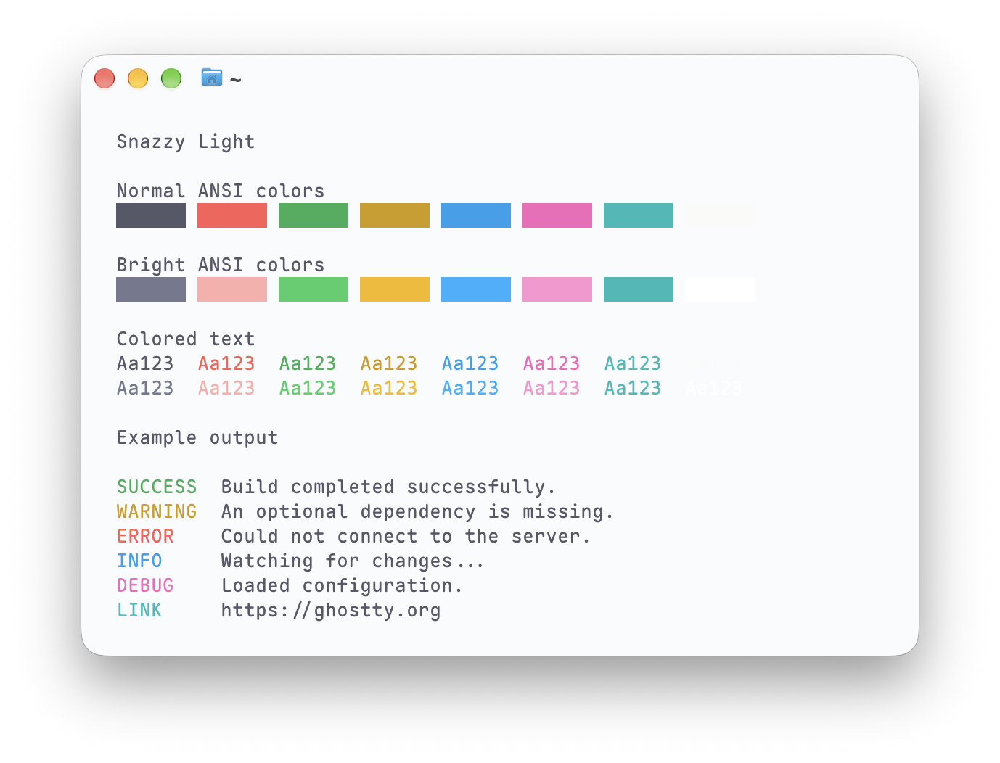

# Snazzy Light for Ghostty

A bright and colorful theme for Ghostty, adapted from [Snazzy Light for VS Code](https://github.com/loilo/vscode-snazzy-light). 🍭 It keeps the original terminal ANSI colors in Ghostty’s native theme format.

## Preview



The screenshot uses [Maple Mono](https://github.com/subframe7536/maple-font) by subframe7536, with the **Normal NF** variant and **Medium** weight.

## Install

From the repository’s directory, copy the theme into Ghostty’s custom themes folder:

```sh
theme_dir="${XDG_CONFIG_HOME:-$HOME/.config}/ghostty/themes"
mkdir -p "$theme_dir"
cp "Snazzy Light" "$theme_dir/Snazzy Light"
```

## Use

Add this to your Ghostty config, then reload it:

```ini
theme = Snazzy Light
```

You can also pair it with Ghostty’s built-in Snazzy dark theme to follow your system appearance:

```ini
theme = light:Snazzy Light,dark:Snazzy
```

The theme sets only colors, so you can choose your own background opacity, blur, fonts, and platform options separately. Any existing color overrides in your Ghostty config take precedence over the theme.

See [Ghostty’s theme documentation](https://ghostty.org/docs/features/theme) for theme installation and configuration details.

## License

Released under MIT. See [LICENSE](LICENSE) for the original copyright and permission notice from Florian Reuschel. The ANSI palette comes from Snazzy Light, while the cursor and selection colors are adapted for this port.

🍬 👻 🍭